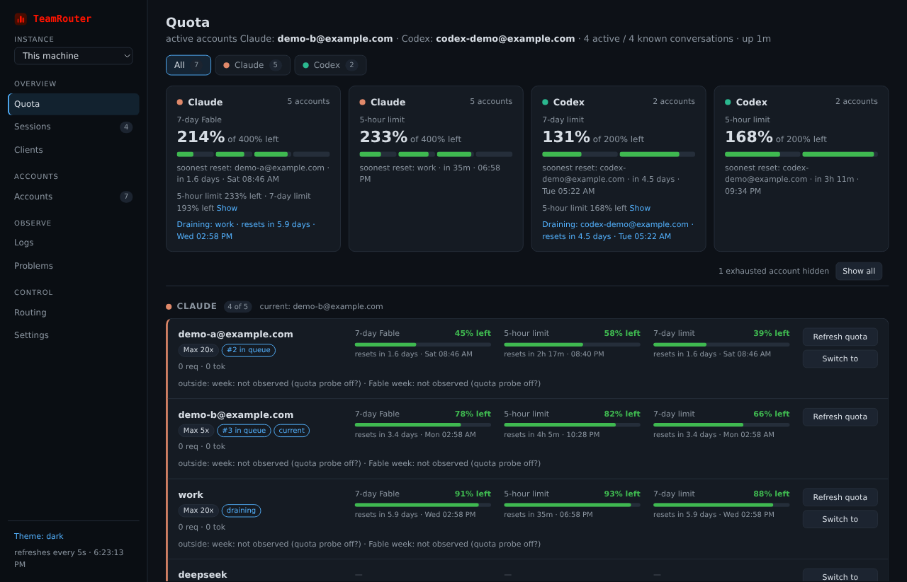
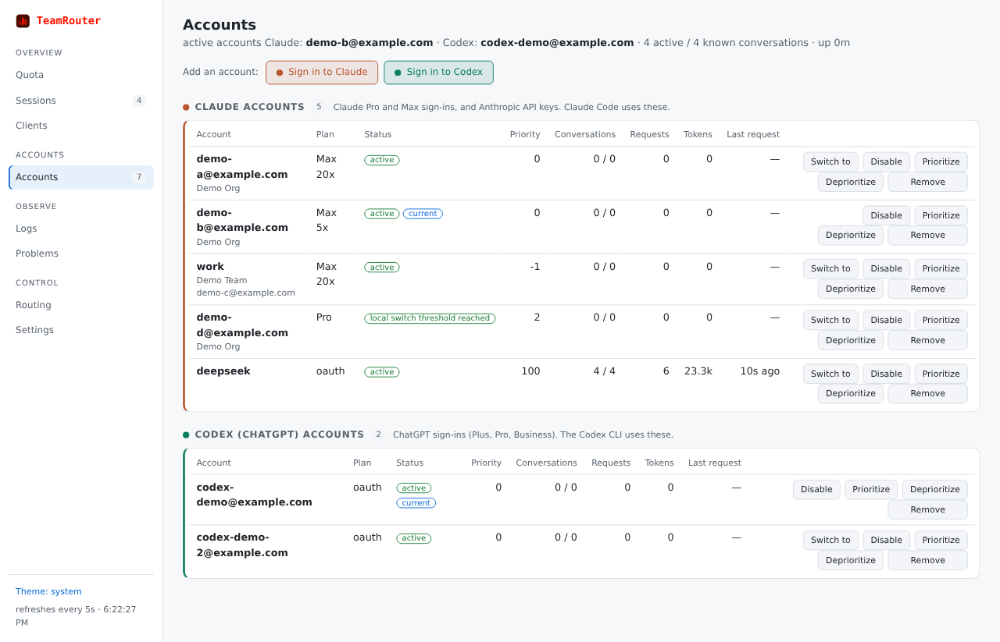
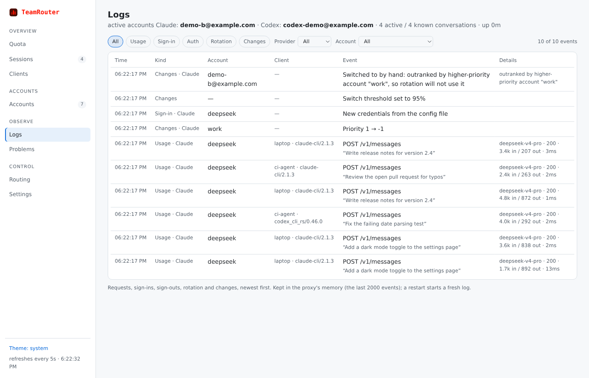
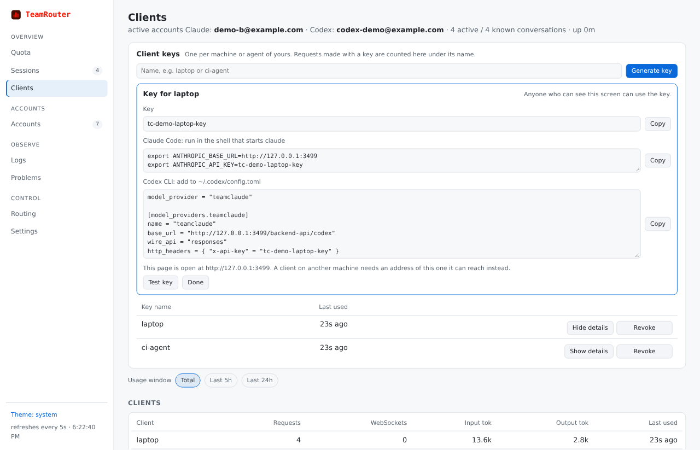
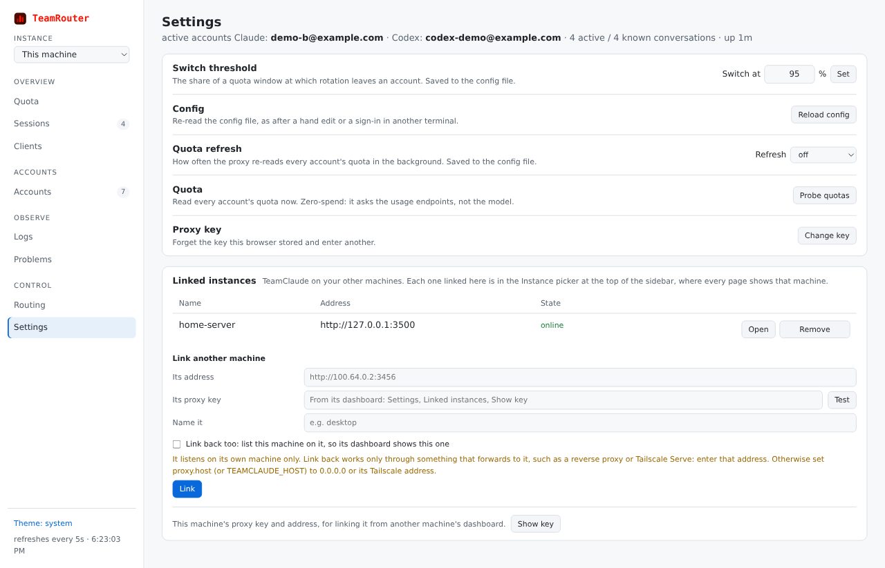
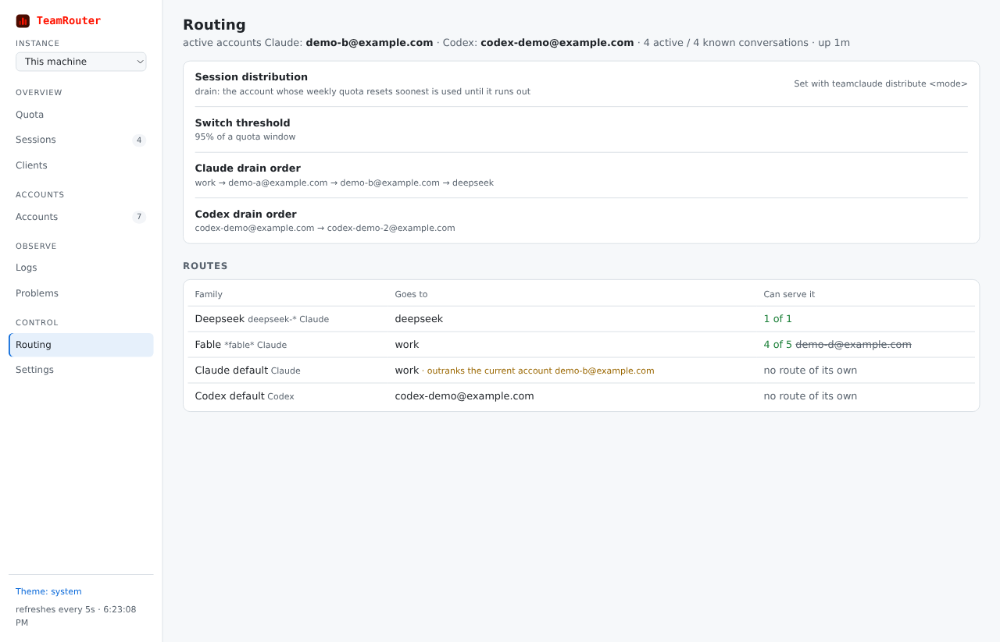
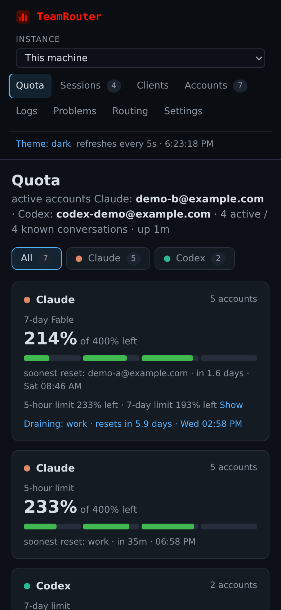
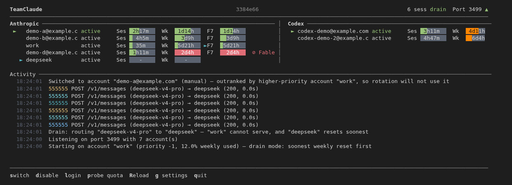

# TeamRouter

*Formerly TeamClaude. Both names work: see [The rename](#the-rename).*

[](https://github.com/l0cky12/teamclaude/actions/workflows/ci.yml)
[](https://www.npmjs.com/package/@karpeleslab/teamclaude)
[](https://nodejs.org)
[](LICENSE)

TeamRouter is a local proxy that pools your own AI coding accounts and moves between them before any one of them hits its limit.

You point [Claude Code](https://claude.com/product/claude-code) or the [Codex CLI](https://github.com/openai/codex) at it, and it handles the rest. It holds your Claude Max, ChatGPT/Codex, API-key and third-party backend (DeepSeek, z.ai/GLM, NanoGPT) accounts. When the account in use gets close to its 5-hour or weekly limit, the next request goes to another one. Your sessions keep running instead of stopping on a rate-limit error.

You control it from a terminal UI, the command line, or a web dashboard that works from any machine on your network.



*Every screenshot in this README uses made-up demo accounts.*

New in this fork: a redesigned web dashboard, sign-in from the browser, client keys, linked instances, account export, and two new routing modes. See [What's new in this fork](#whats-new-in-this-fork).

## Who it is for

**One person, with their own accounts.** The "team" is your agents: if you run ten or fifty coding sessions at once, one subscription isn't enough, and switching accounts by hand every time one fills up gets old fast. TeamRouter does that switching for you.

It is not for sharing accounts between people, it is not a hosted service, and it only drives each provider's own client (Claude Code on Claude accounts, the Codex CLI on Codex accounts). See [Scope](#scope).

## Install

You need Node.js 20 or later. TeamRouter has no runtime dependencies.

**From npm** (the published release):

```bash
npm install -g @karpeleslab/teamclaude
```

**From this repository**, to run changes that haven't been released to npm yet:

```bash
git clone https://github.com/l0cky12/teamclaude.git
cd teamclaude
npm link
```

A git checkout never updates itself. Use `git pull` to update it.

**Other ways to run it:**

- **Docker:** `ghcr.io/karpeleslab/teamclaude`. See [Running in a container](docs/usage.md#running-in-a-container). If you build it with `docker compose` from a checkout, `scripts/redeploy.sh` pulls, rebuilds and restarts it in one command, and rolls back if the new build is unhealthy. See [Updating a compose deployment](docs/usage.md#updating-a-compose-deployment-in-one-command).
- **Nix:** a flake with NixOS and Home Manager modules. See [nix/README.md](nix/README.md).
- **As a background service:** `teamclaude service install` starts the proxy at login and restarts it if it stops (systemd on Linux, a LaunchAgent on macOS).

## Quick start

```bash
teamclaude login           # sign in to a Claude account in your browser; repeat for each account
teamclaude login --codex   # sign in to a ChatGPT/Codex account
teamclaude server          # start the proxy (shows the terminal UI)
```

Then, in another terminal:

```bash
teamclaude run             # Claude Code, through the proxy
teamclaude dashboard       # or open the web dashboard
```

Some shortcuts:

- Already signed in to Claude Code? `teamclaude import` copies that sign-in instead.
- Want plain `claude` to always use the proxy? Run `teamclaude alias --install`.
- Signing in on a server over SSH? `teamclaude login --token` gives you a link to open on any device and a box to paste the code into.

More on accounts, including API keys and one email in several organisations: [docs/accounts.md](docs/accounts.md).

## What it does

### Keeps your sessions running

- **Switches accounts before a limit.** When an account reaches 98% of its 5-hour or weekly limit (you can change the number), new requests go to the next account. If a request does hit a spent limit, it is sent again on another account, so Claude Code never sees the error while any account still has room.
- **Tracks each model's limit on its own.** An account that is out of Fable quota still serves Opus and Sonnet.
- **Knows a spent limit from a short burst limit.** A per-minute rate limit doesn't make it switch accounts for good. The request tries one other idle account at most, then waits, so a burst isn't passed down the whole pool and prompt caches stay warm.
- **Can wait instead of failing.** With `holdSeconds` set, a request that arrives when every account is spent is held open until an account resets (up to that many seconds) instead of failing. An unattended run then finishes on its own. Off by default.
- **Can fall back to paid extra usage.** With `allowExtraUsage` on, Anthropic's paid extra usage is used only after every account's free quota is gone, and stops as soon as a window resets. Off by default, because it costs money.
- **Refreshes sign-ins by itself**, before they expire, and saves the new tokens.

### Chooses accounts the way you want

Set `distributeSessions` (or run `teamclaude distribute <mode>`) to pick how conversations are spread across accounts:

| Mode | What it does |
| --- | --- |
| `off` (default) | Everything uses the current account until it nears its limit. |
| `on` | Each new conversation goes to the least busy account and stays there, so its prompt cache is reused. |
| `adaptive` | Fills the account with the least weekly quota left first, so less quota is wasted when windows reset. Takes plan size (Pro, Max 5x, Max 20x) into account. |
| `affinity` | Uses an account whose 5-hour window is about to reset first, and never moves a conversation while its account can still serve it. |
| `drain` | Uses the account whose weekly limit resets soonest until it runs out, then the next one. It moves early if an account that resets even sooner becomes available again. |

You can also set a priority order, send certain models to certain accounts (`teamclaude route`), or pin one session to one account with `TC_ACCT`. Details: [docs/routing.md](docs/routing.md).

### A web dashboard you can use from anywhere

Open `http://localhost:3456/teamclaude/dashboard`, or run `teamclaude dashboard`. To use it from another machine, set `proxy.host` to `0.0.0.0` (or a Tailscale or LAN address), open the same page at that address, and enter the proxy key.

- **Quota:** how much is left on every account, as 5-hour, weekly and Fable bars with reset times. Tabs for Claude, Codex and each backend, plus pooled summary cards. Accounts that are out of quota are hidden until you ask to see them. Enabled accounts whose quota can be read get a **Refresh quota** button, which checks it without spending any.
- **Accounts:** **Sign in to Claude** and **Sign in to Codex** buttons add accounts from the browser, including from a phone or another computer. You can also sign an account in again, remove it, switch to it, disable it, or move it up or down the priority order.
- **Logs:** every request, sign-in, sign-out, account switch and settings change, with filters by kind, provider and account. Each request shows which client sent it. Turn on `proxy.logPrompts` to also see the prompt that started it.
- **Clients:** create a separate key for each machine or agent. The dashboard shows the exact settings to paste into Claude Code or `~/.codex/config.toml`, and how much each key has used over the last 5 hours, 24 hours, or all time.
- **Sessions, Routing and Settings:** what each conversation spent, which account each model goes to, the switch threshold, and the background quota check (off, or every 5 to 120 seconds).
- **Linked instances:** run TeamRouter on more than one machine (a desktop and a server, say) and link them from **Settings**. One dashboard can then show and control all of them. Linking a machine to one that is already linked to others links it to those too. Off until you link something.

Light and dark themes follow your system, and the layout fits a phone. Full tour: [docs/usage.md](docs/usage.md#status-dashboard-browser).

<table>
  <tr>
    <td width="50%"><br><b>Accounts:</b> sign in to Claude or Codex from the browser, and switch, disable, reorder or remove any account.</td>
    <td width="50%"><br><b>Logs:</b> each request with the client that sent it and its prompt, plus sign-ins, switches and settings changes.</td>
  </tr>
  <tr>
    <td width="50%"><br><b>Clients:</b> a key per machine or agent, with the settings to paste into Claude Code or the Codex CLI.</td>
    <td width="50%"><br><b>Settings:</b> the switch threshold, how often quota refreshes, and your linked machines.</td>
  </tr>
  <tr>
    <td width="50%"><br><b>Routing:</b> the distribution mode, the drain order, and which account each model goes to.</td>
    <td width="50%" align="center"><br><b>On a phone:</b> the same dashboard on a narrow screen.</td>
  </tr>
</table>

### A terminal UI too

`teamclaude server` shows each account's 5-hour, weekly and Fable bars with reset countdowns, Claude and Codex side by side, and a live activity log. Keys let you switch accounts, disable one, sign in, refresh quota and change settings without stopping the proxy.



### Works with more than Claude

- **Codex (ChatGPT) accounts** are pooled next to Claude accounts on the same port, with their own quota and rotation.
- **Third-party backends** (DeepSeek, z.ai/GLM, NanoGPT, or any Anthropic-compatible API) can act as a low-priority fallback for when your Claude accounts run out.
- **Free resets get used.** With `autoRedeemResets` on (off by default), banked Claude usage-limit resets and Codex rate-limit reset credits can be spent automatically when no account has room left. A Codex credit that expires within three days is also spent on an account whose weekly limit is used up, rather than being lost.

### Moves with you between machines

- **Export and import accounts.** `teamclaude accounts export <file>` writes every sign-in to a passphrase-encrypted file. `teamclaude accounts import <file>` sets up a new machine without signing in again.
- **Keep the same accounts live on several machines** with callback.net sync, which stops two machines from signing each other out. Turn it on from the dashboard's Settings page, for each linked machine too.

### Fits into your network

- **Catches hard-coded addresses.** By default `teamclaude run` routes Claude Code through a local HTTPS proxy, so tools that call `api.anthropic.com` directly (the Claude Design MCP, for one) still go through the pool.
- **Per-account proxies.** Send one account's traffic through its own HTTP or SOCKS proxy (`teamclaude routing <name> socks5h://…`). If that proxy goes down, requests move to another account.
- **An upstream proxy** for everything, and residential egress through sx.org.

### Lets your agents see it too

Turn on the MCP endpoint (`"proxy": { "mcp": "read" }`) and Claude Code can check quota, or with `"full"` switch accounts and change settings, from inside a session. Off by default.

### Spends nothing behind your back

The optional features that make extra calls or use quota are off until you turn them on: quota probing, keep-warm requests, extra usage, spending resets, holding requests, MCP and session titles.

Two things do run on their own. Sign-ins are refreshed before they expire. An npm install also checks for a new version at most once a day and installs it; turn that off with `"autoUpdate": false` or `TEAMCLAUDE_DISABLE_AUTOUPDATE=1`.

## What's new in this fork

This fork ([l0cky12/teamclaude](https://github.com/l0cky12/teamclaude)) adds the following to upstream TeamClaude. Each item links to its pull request.

**Web dashboard**

- A redesigned dashboard: a sidebar of pages, provider tabs (Claude, Codex, each backend), one row per account with its quota bars, and a Logs page ([#4](https://github.com/l0cky12/teamclaude/pull/4)).
- The red TeamRouter logo in the sidebar and browser tab ([#10](https://github.com/l0cky12/teamclaude/pull/10)).
- **Refresh quota** on enabled accounts whose quota can be read, and the Fable bar shown first ([#3](https://github.com/l0cky12/teamclaude/pull/3)).
- 5-hour limit cards for Claude and Codex next to the weekly ones ([#12](https://github.com/l0cky12/teamclaude/pull/12)).
- Accounts with no quota left are hidden until you press **Show all** ([#13](https://github.com/l0cky12/teamclaude/pull/13)).
- **Sign in to Claude** and **Sign in to Codex** from the Accounts page, from any device, and **Remove** for an account ([#5](https://github.com/l0cky12/teamclaude/pull/5), [#9](https://github.com/l0cky12/teamclaude/pull/9)).
- The sign-in email shown under an account you renamed ([#8](https://github.com/l0cky12/teamclaude/pull/8)).
- Client keys: create and revoke them on the Clients page, and see a key's connection settings again later ([#15](https://github.com/l0cky12/teamclaude/pull/15), [#17](https://github.com/l0cky12/teamclaude/pull/17)).
- Pick how often quota refreshes in the background, from 5 to 120 seconds, on the Settings page ([#16](https://github.com/l0cky12/teamclaude/pull/16)).
- The Sessions table shown by default ([#14](https://github.com/l0cky12/teamclaude/pull/14)).
- The Logs page shows which client sent each request and, if you turn on `proxy.logPrompts`, its prompt ([#18](https://github.com/l0cky12/teamclaude/pull/18)).
- Linked instances: link TeamRouter on your other machines and control them all from one dashboard, set up from the Settings page ([#20](https://github.com/l0cky12/teamclaude/pull/20), [#21](https://github.com/l0cky12/teamclaude/pull/21)).

**Routing**

- `affinity` mode: use an account whose 5-hour window is about to reset first, and keep each conversation on its account while it can still serve it ([#2](https://github.com/l0cky12/teamclaude/pull/2)).
- `drain` mode: use the account whose weekly limit resets soonest until it runs out, moving early if one that resets even sooner becomes available ([#6](https://github.com/l0cky12/teamclaude/pull/6)).

**Accounts**

- `teamclaude accounts export` and `accounts import`: move your sign-ins to another of your machines in a passphrase-encrypted file ([#19](https://github.com/l0cky12/teamclaude/pull/19)).

**Project**

- CI tests the npm package and the container, publishing waits for CI, and security scans run on every change ([#11](https://github.com/l0cky12/teamclaude/pull/11)).
- An `AGENTS.md` guide for AI coding agents, with a Codex review step and screenshot rules for front-end changes ([#1](https://github.com/l0cky12/teamclaude/pull/1), [#7](https://github.com/l0cky12/teamclaude/pull/7)).

## Everyday commands

```bash
teamclaude accounts              # list accounts, their plan and sign-in status
teamclaude status                # live status of a running proxy
teamclaude switch <name>         # prefer one account now
teamclaude disable <name>        # take an account out of rotation (enable to undo)
teamclaude priority <name> 1     # set rotation order, lower is used first
teamclaude threshold 90          # switch accounts at 90% instead of 98%
teamclaude distribute adaptive   # pick how conversations are spread
teamclaude attach                # open the terminal UI of a running proxy
teamclaude help                  # everything else
```

Every command: [docs/usage.md](docs/usage.md#command-reference).

## Configuration

Settings live in `~/.config/teamclaude.json` (or `$XDG_CONFIG_HOME`). The file is meant to be edited by hand, and most settings can also be changed from the dashboard, the terminal UI or the CLI while the proxy runs. A proxy key is created the first time you start it.

Quota readings are kept in `teamclaude.state.json` next to it. You can delete that file safely: quota is learned again from traffic.

Every setting and environment variable: [docs/configuration.md](docs/configuration.md).

## How it works

1. Claude Code or Codex sends its request to the local proxy instead of the provider.
2. The proxy picks an account that has room, adds that account's sign-in, and forwards the request.
3. The provider's reply says how much quota the account has left. The proxy records it, so it knows when to move on, even after a restart.
4. If the reply says the account's limit is spent, the request is sent again on another account. A short burst limit gets one try on another account at most. If every account is spent, the proxy either waits (`holdSeconds`) or returns the error.

Step by step: [docs/routing.md](docs/routing.md#request-lifecycle).

## Documentation

| Page | What's in it |
| --- | --- |
| [Accounts](docs/accounts.md) | Signing in from the CLI or dashboard, API keys, several organisations, Codex accounts, third-party backends, export/import, callback.net sync, per-account proxies, signing in over SSH |
| [Usage](docs/usage.md) | The server and terminal UI, running Claude Code, the web dashboard, linked instances, the MCP endpoint, every command, logging, Docker |
| [Routing](docs/routing.md) | How accounts are chosen, the distribution modes, model routes, pinning, the prompt cache |
| [Quota](docs/quota.md) | How quota is read, probing, keep-warm, thresholds, spending caps, extra usage, holding |
| [Configuration](docs/configuration.md) | The config file, every setting, environment variables |
| [Proxy modes](docs/proxy-modes.md) | The local HTTPS proxy, upstream proxies, per-account proxies, sx.org |
| [Compliance](docs/compliance.md) | Who the project is for, and notes on each provider's terms |
| [Contributing](CONTRIBUTING.md) | What's in scope, and what a pull request needs |

## The rename

TeamClaude is becoming **TeamRouter**, because it now pools Codex and other backends as well as Claude. The rename is happening over several releases so that nothing you have installed, scripted or configured breaks ([issue #72](https://github.com/KarpelesLab/teamclaude/issues/72)).

For now both names work everywhere:

- `teamrouter` runs the same CLI as `teamclaude`.
- Every `TEAMCLAUDE_*` environment variable can also be written `TEAMROUTER_*`.
- Every `/teamclaude/…` address also answers at `/teamrouter/…`.
- `~/.config/teamrouter.json` is used if it exists.

The dashboard already uses the TeamRouter name. You don't need to change anything on an existing install.

## Security

The only official sources are [github.com/KarpelesLab/teamclaude](https://github.com/KarpelesLab/teamclaude) and the [`@karpeleslab/teamclaude`](https://www.npmjs.com/package/@karpeleslab/teamclaude) npm package. It is **never** distributed as a downloadable binary or `.zip`, so don't run one that claims to be it. To report a problem, see [SECURITY.md](SECURITY.md).

## Scope

TeamRouter is a local proxy that holds your own sign-ins and drives each provider's own CLI, for one person's work. That holds for every provider it supports:

- **One person, their own accounts.** Not account sharing, not a hosted service, not resale.
- **The provider's own client.** Claude Code on Claude accounts, the Codex CLI on Codex accounts. Other tools can't use subscription sign-ins through it.
- **A third-party backend is just another account:** a key you were given, used under that company's terms.

How this fits each provider's terms, including the common question about holding several subscriptions, is in [docs/compliance.md](docs/compliance.md). It isn't legal advice. Changes outside this scope aren't merged; see [CONTRIBUTING.md](CONTRIBUTING.md).

## License

MIT. See [LICENSE](LICENSE).
